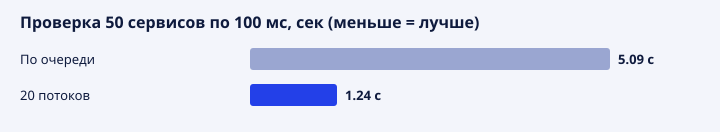
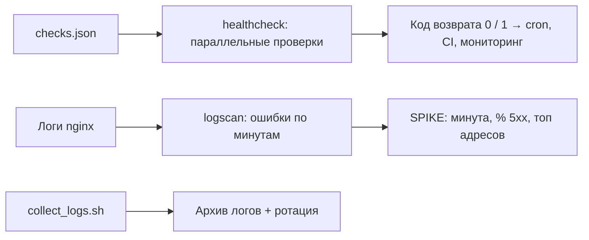

# ⚙️ ops-automation-scripts

Утилиты для эксплуатации на Python и Bash: находят сбой раньше пользователей и сами указывают на источник


## 📊 Результат (реальные замеры, `python bench.py`)



| Утилита | Что замерено | Результат |
|---|---|---|
| `healthcheck` | 50 сервисов по 100 мс | 5.09 с → **1.24 с (×4.1)** на 20 потоках |
| `logscan` | 499 920 строк лога | **0.47 с, ~1.07 млн строк/с** |
| `logscan` | искусственный инцидент в 11:17 | найден точно в нужную минуту: 1907 ошибок 5xx, виновник `/api/orders` |
| Тесты | 10 штук | зелёные, в CI |

**В рабочей среде** утилиты такого типа экономили около 6 часов в неделю и позволяли замечать сбои раньше пользователей. Среднее время решения заявок сократилось примерно на 30%.

## 💡 Простыми словами

Раньше о проблеме узнавали из звонка «ничего не работает». Эти утилиты работают как дежурный: `healthcheck` опрашивает сервисы, порты и диски, а `logscan` читает логи и показывает, в какую минуту начались ошибки и какой адрес ломается.

## 🏗 Как это работает



## ✨ Что внутри

| Файл | Что делает |
|---|---|
| `ops/healthcheck.py` | HTTP / TCP / диск, параллельно, код возврата для автоматизации, `--json` |
| `ops/logscan.py` | Находит всплески 5xx статистикой (среднее + 3σ) и показывает топ адресов |
| `ops/loggen.py` | Детерминированный генератор логов с инцидентом: для тестов и демо |
| `scripts/collect_logs.sh` | Сбор логов в архив с временной меткой и ротацией (`set -euo pipefail`) |
| `tests/` | Реальные HTTP/TCP-серверы в тестах, границы, мусорные строки, «тихий» трафик |

## 🚀 Запуск

```bash
python -m pytest -q
python -m ops.healthcheck checks.example.json
python -m ops.loggen 100000 > access.log && python -m ops.logscan access.log   # код возврата 2 = всплеск найден
bash scripts/collect_logs.sh ./out 7 /var/log/nginx
python bench.py
```

рутину превращаю в код, который можно запускать по расписанию и встраивать в мониторинг. Автоматизация экономит время команды и сокращает простой.
